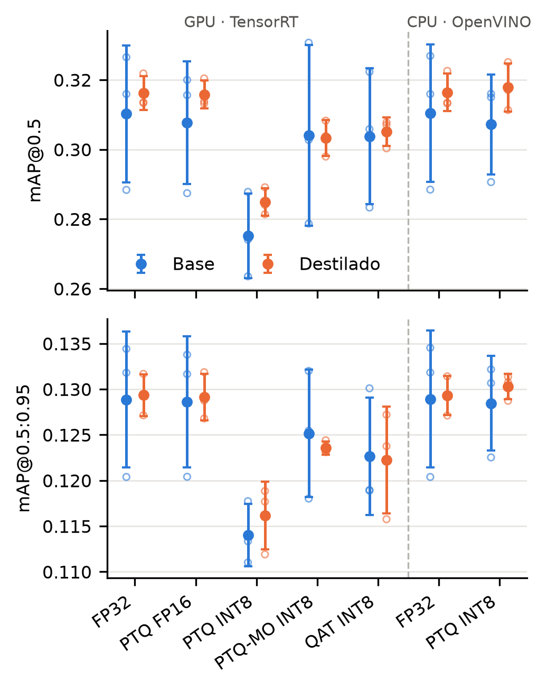

# Destilación de conocimiento vs. pérdida por cuantización en YOLO (detección de daños viales)

Código del paper (IEEE, en preparación) que estudia si la **destilación de conocimiento (KD)** hace que un
detector YOLO ligero pierda menos precisión al **cuantizarse a INT8**, usando el subconjunto India de
RDD2022.

> El diseño experimental completo (las decisiones que no se cambian sin justificarlo) está en
> [CLAUDE.md](CLAUDE.md). La bitácora con fechas, comandos y resultados de cada fase está en
> [results/LOG.md](results/LOG.md). Este README es la guía de uso: qué hace cada fase y cómo se ejecuta.

---

## 1. Objetivos, preguntas e hipótesis

**Objetivo general:** evaluar si la destilación de conocimiento (KD) mejora el desempeño y la calibración de un
YOLO11n cuantizado a INT8 con PTQ y QAT, y si reduce su pérdida respecto de la versión FP32, en la detección de
daños viales. Una pregunta por objetivo específico y una familia de hipótesis por pregunta (Pk ↔ Hk; replanteado el
2026-11-02, ver [CLAUDE.md](CLAUDE.md) y `results/tables/protocol_deviations.csv`).

Definiciones (mAP@0.5 de 4 clases, en test y dentro del mismo motor, TensorRT):
- **dmAP50** = mAP@0.5(FP32) − mAP@0.5(cuantizado): pérdida por cuantización de un alumno.
- **ECE**: detecciones con confianza ≥ 0.25, emparejadas con las cajas reales por IoU ≥ 0.5 (greedy por confianza),
  correctas si coincide la clase; 15 intervalos de igual ancho. **ΔECE** = ECE(INT8) − ECE(FP32).
- **Convención de signo:** D > 0 favorece SIEMPRE al alumno KD.

| OE | Objetivo específico | P | Pregunta | H | Estadístico D | Contraste | Tipo |
|---|---|---|---|---|---|---|---|
| OE1 | Entrenar YOLO11n con y sin KD (maestro YOLO11m) y comparar en FP32 | **P1** | ¿La KD mejora al alumno en FP32? | **H1** | mAP50 KD − mAP50 base, FP32 | bilateral | exploratoria |
| OE2 | Cuantizar ambos alumnos a INT8 (PTQ y QAT) y comparar su mAP cuantizada y su pérdida, global y en baches | **P2** | ¿El alumno KD cuantizado supera al base cuantizado con el mismo método? | **H2a** | mAP50 KD − mAP50 base, PTQ INT8 | bilateral | exploratoria |
| | | | | **H2b** | mAP50 KD − mAP50 base, QAT INT8 | bilateral | exploratoria |
| OE2 | (mismo) | **P3** | ¿La KD reduce la pérdida de mAP por cuantización? | **H3a** | dmAP50 base − dmAP50 KD, PTQ INT8 | bilateral | **confirmatoria** |
| | | | | **H3b** | dmAP50 base − dmAP50 KD, QAT INT8 | bilateral | **confirmatoria** |
| OE3 | Evaluar si el alumno KD tiene mejor ECE tras cuantizar y si se deteriora menos | **P4** | ¿El alumno KD cuantizado está mejor calibrado y su calibración se deteriora menos? | **H4a** | ECE base − ECE KD, PTQ INT8 | bilateral | **confirmatoria** |
| | | | | **H4b** | ECE base − ECE KD, QAT INT8 | bilateral | **confirmatoria** |
| | | | | **H4c** | ΔECE base − ΔECE KD, PTQ INT8 | bilateral | exploratoria |
| | | | | **H4d** | ΔECE base − ΔECE KD, QAT INT8 | bilateral | exploratoria |
| OE4 | Determinar si el alumno KD con PTQ no es inferior al base con QAT | **P5** | ¿KD + PTQ alcanza a base + QAT? | **H5** | mAP50 (KD + PTQ INT8) − mAP50 (base + QAT INT8) | no inferioridad, δ = 0.010 | **confirmatoria** |
| OE5 | Medir la eficiencia en GPU y CPU | — | Descriptivo | — | latencia, FPS, MB | — | — |

Relación entre P1, P2 y P3: **H2 = H1 + H3** (la ventaja del KD cuantizado es su ventaja en FP32 más su menor
pérdida).

Cómo se contrastan:
- **Familia confirmatoria** (5 contrastes, α global = 0.05, corrección de Holm): H3a, H3b, H4a, H4b y H5. Son los
  mismos 5 contrastes fijados antes de ver test (antes llamados H1a, H1b, H2a, H2b y H3).
- **Exploratorias** (H1, H2a, H2b, H4c, H4d; agregadas el 2026-11-02, después de ver test en India y antes en Japón):
  solo IC 95 % y signos por semilla, sin valor p.
- **Bootstrap pareado:** B = 1 000 remuestreos con reemplazo de las imágenes de test (semilla 42), con los mismos
  índices para todos los modelos. Cada diferencia se calcula por semilla (base_s vs. KD_s, s = 0, 1, 2) y se promedia
  sobre las 3 semillas.
- **Valor p (bootstrap centrado, Efron y Tibshirani, 1993):**
  - bilateral: p = (1 + #{ |D\*_b − D_obs| ≥ |D_obs| }) / (B + 1)
  - H5: p = (1 + #{ D\*_b − D_obs ≥ D_obs + δ }) / (B + 1)
- **Holm** sobre los 5 valores p (se reportan p crudo y p ajustado). H5 concluye no inferioridad si el límite inferior
  del IC 90 % supera −δ.
- **Consistencia entre semillas:** signo de D en cada semilla (p. ej., "2/3 semillas positivas"), descriptivo.
- **Otros exploratorios** (E01–E18, IC 95 %, sin valor p): AP@0.5 de D40, dmAP con mAP@0.5:0.95, mAP sin D10,
  pérdida del maestro frente a los alumnos, FP16 frente a FP32, precisión y recall en INT8, PTQ-MO y OpenVINO.
- **Japón (D9):** mismas hipótesis y misma corrección de Holm, por separado; la coincidencia entre datasets se
  reporta de forma descriptiva.

Resultados de India: [Fase 7](#fase-7--estadística-india) y Tabla VII en [Fase 9](#fase-9--tablas-y-figura-del-paper).

**Idea general del experimento**

```
                   ┌──────────────── maestro YOLO11m (congelado) ───────────────┐
                   │                                                             ▼
datos RDD2022-India ──► alumno YOLO11n BASE (solo L_det)          alumno YOLO11n KD (L_det + λ·L_CWD)
                              │                                                 │
                              ▼                                                 ▼
                 FP32 · FP16 · INT8 (PTQ) · INT8 (QAT)        FP32 · FP16 · INT8 (PTQ) · INT8 (QAT)
                              │                                                 │
                              └──────────► evaluación en test, ECE, bootstrap ◄─┘
```

Los dos alumnos usan exactamente los mismos hiperparámetros; **la única diferencia es la pérdida de
destilación CWD**. Cada alumno se entrena con 3 semillas (0, 1, 2) para medir la variabilidad del
entrenamiento.

---

## 2. Estado del proyecto

| Fase | Qué es | Estado |
|---|---|---|
| 0 | Entorno y estructura | ✅ |
| 1 | Preparación de datos y auditoría | ✅ |
| 1b | Pruebas de tiempo (AMP vs. FP32) | ✅ |
| 2 | Maestro YOLO11m | ✅ |
| 2b | Segundo maestro candidato YOLO11l y selección | ✅ (se usa el 11m) |
| 3 | Alumnos base (3 semillas) | ✅ |
| 4a | Implementación de CWD | ✅ |
| 4b | Piloto de λ (λ = 1.0) y alumnos KD (3 semillas) | ✅ |
| 5 | Cuantización PTQ (TensorRT y OpenVINO) | ✅ |
| 5b | QAT con NVIDIA ModelOpt | ✅ |
| 6 | Evaluación en test (mAP, ECE) | ✅ PTQ (la QAT se evalúa con el mismo código) |
| 7 | Estadística (bootstrap, Holm) | ✅ India |
| 8 | Eficiencia (latencia, FPS, tamaño) | ✅ India |
| 9 | Tablas y figuras del paper | ✅ India (columnas de Japón en J9) |
| J1 | Réplica en Japón: datos y auditoría | ✅ |
| J2–J9 | Réplica en Japón: maestro, alumnos, cuantización, evaluación, estadística | ⏳ J2–J4b hechos (λ = 1.0); siguiente J4c, alumnos KD (ver checklist) |

### Primer avance (2026-10-31)

Hito presentado como **primer avance** del proyecto (etiqueta git `primer-avance`; guion de la exposición en
[presentacion.md](presentacion.md)):

- **India completa (Fases 0–9):** datos, maestro, alumnos base y KD (3 semillas), PTQ (TensorRT y OpenVINO), QAT
  (ModelOpt), evaluación en test, estadística D7, eficiencia con el reloj de la GPU fijado y tablas y figura del
  paper. Resultado: ninguna de las 5 hipótesis rechaza H0 tras Holm; la KD no protege contra la pérdida por
  cuantización y base + QAT supera a KD + PTQ.
- **Japón hasta J4b:** datos (J1), maestro YOLO11m (J2), alumnos base (J3), prueba de humo de la KD (J4a) y piloto
  de λ (J4b, λ = 1.0). El test de Japón aún no se ha mirado.
- **Cómputo:** 77 h de GPU (`results/tables/compute_budget.csv`).
- **Pendiente tras el avance:** J4c–J9 de Japón, sensibilidad a la calibración (exploratorio) y correcciones del
  paper para alinearlo con este repositorio.

### Resultados hasta ahora (validación)

Todos se obtuvieron en el split de **validación**; el split test no se ha usado y queda reservado para la
Fase 6. Métricas de best.pt revalidado con imgsz 640, batch 8, conf 0.001 e iou 0.7 (media ± d.e. de 3
semillas para los alumnos):

| Modelo | mAP@0.5 | mAP@0.5:0.95 | AP@0.5 D40 | mAP@0.5 sin D10 |
|---|---|---|---|---|
| Maestro YOLO11m | 0.345 | 0.147 | 0.437 | 0.449 |
| Alumnos base YOLO11n | 0.342 ± 0.022 | 0.145 ± 0.006 | 0.397 ± 0.005 | 0.424 ± 0.020 |
| Alumnos KD YOLO11n (λ = 1.0) | 0.347 ± 0.008 | 0.147 ± 0.001 | 0.411 ± 0.016 | 0.437 ± 0.012 |

- La KD mejora levemente al alumno en FP32 (sobre todo en D40) y reduce mucho la variabilidad entre
  semillas (d.e. de mAP@0.5:0.95: 0.001 frente a 0.006).
- La PTQ INT8 degrada a los alumnos base en 3/3 semillas: −3.1 puntos de mAP@0.5 (−9.5 %) y −4.3 en D40,
  con más precisión y menos recall (−10.9 %). FP16 no pierde precisión (exploración `ptq_check`).

### Resultados en test (Fases 5, 5b y 6; descriptivos, la inferencia es la Fase 7)

Todos los modelos con letterbox cuadrado 640×640 y batch 1; pérdida = FP32 − cuantizado dentro de TensorRT
(media ± d.e. de 3 semillas):

| | mAP@0.5 FP32 | Pérdida PTQ INT8 | Pérdida control ModelOpt PTQ | Pérdida QAT INT8 | ECE PTQ INT8 | ECE QAT INT8 |
|---|---|---|---|---|---|---|
| Alumnos base | 0.310 ± 0.020 | 0.035 ± 0.009 | 0.006 ± 0.009 | 0.006 ± 0.003 | 0.096 | 0.077 |
| Alumnos KD | 0.316 ± 0.005 | 0.031 ± 0.007 | 0.013 ± 0.003 | 0.011 ± 0.009 | 0.113 | 0.085 |
| Maestro YOLO11m | 0.329 | 0.178 (colapso de confianzas) | — | — | — | — |

- Con la PTQ de TensorRT (Ultralytics), el alumno KD pierde algo menos (2/3 semillas); con QAT, algo más.
- Casi toda la ganancia de la QAT viene del esquema de cuantización de ModelOpt (Q/DQ explícito), no del ajuste
  fino: el control sin ajuste fino ya pierde casi lo mismo que la QAT. Ese esquema cuantiza casi las mismas
  convoluciones que la PTQ implícita (81 frente a 79 de 88), pero deja más cómputo en FP16 (~41 % de las capas de
  cómputo en INT8, frente a ~65 %), lo que también explica su ~15 % más de latencia. Es una observación
  descriptiva: el mecanismo no se aisló.
- FP16 no pierde nada, y OpenVINO INT8 (NNCF) casi no pierde (≤ 0.3 puntos).
- El maestro colapsa con la PTQ de TensorRT por valores extremos en las activaciones de su cabeza (ver
  "Exploraciones").

---

## 3. Entorno

| Elemento | Valor |
|---|---|
| GPU / CPU / RAM | NVIDIA RTX 4060 8 GB · Intel i7-12700KF · 32 GB (24 GB asignados a WSL) |
| Sistema | WSL2 (Ubuntu 26.04) sobre Windows 11 |
| Python | 3.13, en el venv `~/.venvs/yolokd` (disco de Linux) |
| Librerías clave | PyTorch 2.14 (CUDA 13.0), ultralytics **8.4.164**, TensorRT **10.16**, OpenVINO 2026.4, NNCF 3.4 |

Dos versiones están fijadas a propósito:

- **TensorRT 10, no 11.** La rama 10 conserva la cuantización INT8 implícita con calibrador; la 11 obliga
  a cuantización explícita Q/DQ. TensorRT 10 no tiene versión para Python 3.14, por eso se usa 3.13.
- **ultralytics 8.4.164.** El calibrador INT8 depende de la versión del exportador de Ultralytics.

### Instalación (una sola vez, en WSL)

```bash
cd "/mnt/d/1-Personal/5-Studies/MaestriaIA/S2/Vision de computadora/proyecto_yolo/Codigo"
bash scripts/setup_wsl.sh            # instala uv, crea el venv con Python 3.13 e instala requirements.txt
source ~/.venvs/yolokd/bin/activate
python scripts/check_env.py          # verifica CUDA, TensorRT, OpenVINO y ultralytics → results/env_check.json
```

- `requirements.txt` tiene las dependencias directas con versión fija.
- `requirements.lock.txt` tiene el entorno completo congelado (todas las dependencias).

### Rutas en WSL

El código vive en `D:` (en WSL, `/mnt/d/...`), pero el venv y las imágenes convertidas viven en el disco de
Linux (`~/.venvs/yolokd` y `~/datasets/rdd2022_india_yolo`), porque leer miles de archivos desde `/mnt/d`
es lento. Los scripts calculan las rutas a partir de su propia ubicación, así que funcionan desde
cualquier carpeta.

### Cómo lanzar entrenamientos largos

Todos los entrenamientos se lanzan dentro de `tmux` para que sigan corriendo si se cierra la terminal:

```bash
tmux new -s nombre          # abrir sesión
bash scripts/....sh         # lanzar
# Ctrl+B y luego D          → dejarlo corriendo
tmux attach -t nombre       # volver a verlo
```

Conviene pausar las actualizaciones de Windows durante corridas largas: un reinicio corta el entrenamiento.

---

## 4. Estructura del repositorio

```
Codigo/
├── CLAUDE.md                 diseño experimental y reglas del proyecto
├── README.md                 esta guía
├── requirements.txt          dependencias directas (versiones fijas)
├── requirements.lock.txt     entorno completo congelado
├── configs/                  TODA la configuración (nada fijo dentro del código)
│   ├── data_prep.yaml        preparación de datos (clases, partición, calibración)
│   ├── data.yaml             dataset para Ultralytics (generado, no editar)
│   ├── calib.yaml            500 imágenes de train para calibrar INT8 (generado, no editar)
│   ├── train.yaml            hiperparámetros de maestros y alumnos
│   ├── kd.yaml               destilación CWD: maestro, τ, λ, piloto
│   ├── timing.yaml           pruebas de tiempo (Fase 1b)
│   └── exploracion_ptq.yaml  exploración de la degradación por PTQ
├── data/
│   ├── raw/                  RDD2022 original (no versionado)
│   └── splits/               listas train/val/test/calib (versionadas)
├── src/
│   ├── data/                 conversión, limpieza, partición y estadísticas
│   ├── train/                maestros, alumnos, CWD, piloto de λ, pruebas de tiempo
│   ├── quant/ eval/ bench/ report/   fases 5–9 (por implementar)
│   └── utils/                semillas, versiones y carga de configuración
├── scripts/                  lanzadores .sh, verificación del entorno y exploraciones
├── runs/                     corridas, pesos y exportaciones (no versionado)
├── results/                  LOG.md, tablas, figuras y métricas
└── paper/                    borrador del paper (no versionado)
```

Convención de nombres de corridas: `{rol}_{kd|base}_s{semilla}`, por ejemplo `student_kd_s1`.
El maestro YOLO11m es `teacher_s0` y el YOLO11l, `teacher_l_s0`.

---

## 5. Fases: qué se hace, cómo se ejecuta y qué se obtuvo

### Fase 0 — Entorno

Crea la estructura, fija versiones y verifica que la GPU, TensorRT y OpenVINO funcionen.

| Script | Para qué |
|---|---|
| `scripts/setup_wsl.sh` | crea el venv e instala dependencias |
| `scripts/check_env.py` | verifica el entorno y guarda `results/env_check.json` |
| `src/utils/repro.py` | fija semillas y registra versiones en cada corrida |

### Fase 1 — Datos

Convierte las anotaciones Pascal VOC (XML) de `data/raw/RDD2022/India/train` a formato YOLO, aplica las
reglas de limpieza, particiona y genera los yaml para Ultralytics. El test oficial de RDD2022 no tiene
etiquetas, así que train/val/test salen del train oficial.

```bash
python -m src.data.prepare_dataset     # conversión, limpieza, partición, calibración, auditoría
python -m src.data.dataset_stats       # imágenes e instancias por clase y split
```

- **Clases:** D00 (grieta longitudinal), D10 (grieta transversal), D20 (piel de cocodrilo), D40 (bache).
- **Limpieza:** se eliminan solo las cajas de otras etiquetas (D01, D11, D43, D44, D50 y una caja ambigua
  "D0w0"); ninguna imagen se elimina. Las imágenes sin cajas se conservan como fondo (58 %).
- **Partición:** 70/15/15 con estratificación iterativa multietiqueta (semilla 42): 5 396 / 1 144 / 1 166
  imágenes.
- **Calibración INT8:** 500 imágenes de train, estratificadas; nunca se calibra con val ni test.
- **Salidas:** `results/tables/data_audit.csv`, `results/tables/dataset_stats.csv`, `data/splits/`.

Limitación conocida: D10 tiene solo 68 instancias (9 en test). La mAP de 4 clases es la métrica principal
y la mAP sin D10 se reporta como análisis de sensibilidad.

### Fase 1b — Pruebas de tiempo

Mide el tiempo por época y la VRAM antes de comprometer horas de GPU.

```bash
bash scripts/fase1b_tiempos.sh         # src/train/timing_test.py + configs/timing.yaml
```

- Maestro YOLO11m: con AMP, 123 s por época y 4.2 GB; en FP32 satura los 8 GB y es unas 7 veces más lento.
- **Decisión:** precisión mixta (AMP) para todos los modelos. AMP no es cuantización: los pesos se guardan
  en FP32.
- Estimación total del proyecto: unas 41 h de GPU (`results/tables/timing.csv`).

### Fase 2 y 2b — Maestros

```bash
bash scripts/train_teacher.sh                  # YOLO11m → runs/teacher/teacher_s0
bash scripts/train_teacher.sh --rol maestro_l  # YOLO11l → runs/teacher/teacher_l_s0
bash scripts/train_teacher.sh --humo           # prueba rápida (1 época, 5 % de train)
```

Configuración común (`configs/train.yaml`): imgsz 640, batch 8, 300 épocas, SGD (lr0 0.01), aumentación
por defecto de Ultralytics, AMP, `deterministic=True`, caché en disco, parada temprana con paciencia 50.

| Maestro | best.pt (época) | val mAP@0.5 | val mAP@0.5:0.95 | D40 |
|---|---|---|---|---|
| **YOLO11m** | 148 | 0.345 | **0.147** | 0.437 |
| YOLO11l | 105 | 0.339 | 0.144 | 0.426 |

Se entrenó el YOLO11l porque el 11m apenas superaba a los alumnos. La regla, fijada antes de ver el
resultado, era usar el 11l solo si superaba al 11m en al menos 0.010 de mAP@0.5:0.95 en validación. No lo
hizo, así que **el maestro es YOLO11m**. Que un modelo un 26 % más grande no mejore indica que el techo lo
pone el conjunto de datos, no la capacidad.

### Fase 3 — Alumnos base

```bash
for s in 0 1 2; do bash scripts/train_student.sh --kd off --seed $s; done
```

YOLO11n, misma configuración que los maestros, 300 épocas sin parada temprana →
`runs/students/student_base_s{0,1,2}`. Unas 2.7 h por corrida, sin NaN.

**Entrenamiento:**

| Corrida | Época de best.pt | Horas | Pendiente de la mAP en las últimas 50 épocas (mAP@0.5 / mAP@0.5:0.95, por 50 ép.) |
|---|---|---|---|
| base_s0 | 198 | 2.71 | −0.0023 / −0.0027 |
| base_s1 | 238 | 2.73 | −0.0006 / −0.0029 |
| base_s2 | 114 | 2.74 | −0.0021 / −0.0000 |

Las tres corridas convergieron: al final del entrenamiento la mAP de validación está plana o baja levemente.

**Resultados en validación** (best.pt revalidado con imgsz 640, batch 8, conf 0.001, iou 0.7):

| Modelo | mAP@0.5 | mAP@0.5:0.95 | D00 | D10 | D20 | D40 | mAP@0.5 sin D10 |
|---|---|---|---|---|---|---|---|
| base_s0 | 0.366 | 0.151 | 0.344 | 0.149 | 0.568 | 0.401 | 0.438 |
| base_s1 | 0.334 | 0.142 | 0.326 | 0.034 | 0.576 | 0.399 | 0.434 |
| base_s2 | 0.325 | 0.141 | 0.249 | 0.097 | 0.562 | 0.391 | 0.401 |
| **Media ± d.e.** | **0.342 ± 0.022** | **0.145 ± 0.006** | | | | **0.397 ± 0.005** | **0.424 ± 0.020** |
| Maestro YOLO11m (referencia) | 0.345 | 0.147 | 0.311 | 0.034 | 0.597 | 0.437 | 0.449 |

- **Variabilidad entre semillas alta:** 4 puntos de mAP@0.5 entre s0 y s2, lo que justifica entrenar 3
  semillas. Parte viene de D10 (9 instancias en val), cuyo AP salta entre 0.03 y 0.15.
- **El maestro apenas supera a los alumnos.** En mAP@0.5 global, base_s0 lo supera por el AP de D10. Sin D10,
  el maestro gana por unos 2.5 puntos (0.449 frente a 0.424) y en D40 por unos 4 (0.437 frente a 0.397); en
  mAP@0.5:0.95 la diferencia es de 0.2 puntos. Esto motivó probar un maestro más grande (Fase 2b).

### Fase 4a — Destilación CWD

`src/train/cwd.py` implementa **Channel-Wise Distillation** (Shu et al., ICCV 2021) como subclase del
`DetectionTrainer` de Ultralytics. La fórmula está adaptada de MMRazor (commit `0919f69`).

- Se destilan las tres entradas de la cabeza de detección (P3, P4, P5). El maestro está congelado y ve el
  mismo batch aumentado que el alumno.
- Unas convoluciones 1×1 (adaptadores) llevan los canales del alumno (64/128/256) a los del maestro
  (256/512/512). Se entrenan con el alumno, pero **nunca se guardan en best.pt** ni se exportan.
- Pérdida: **L = L_det + λ·L_CWD**, con τ = 1. `results.csv` registra L_CWD por época (`train/cwd`).

```bash
bash scripts/train_student.sh --kd on --seed 0 --humo
bash scripts/train_student.sh --kd off --seed 0 --humo
python -m src.train.check_kd --kd runs/smoke/student_kd_s0_humo --base runs/smoke/student_base_s0_humo
```

`check_kd` verifica que L_CWD baja, que el best.pt del alumno KD tiene exactamente los mismos tensores que
el del base (sin adaptadores ni maestro) y que los ONNX exportados tienen el mismo número de parámetros.

### Fase 4b — Piloto de λ y alumnos KD

**Piloto:** 3 alumnos KD cortos (λ ∈ {0.5, 1.0, 2.0}, semilla 0, 50 épocas). Se elige el λ con mayor
mAP@0.5:0.95 en validación.

```bash
bash scripts/pilot_lambda.sh           # entrena los 3 λ y corre src/train/select_lambda.py
```

| λ | L_CWD (época 1 → 50) | Peso de λ·L_CWD sobre L_det | val mAP@0.5:0.95 |
|---|---|---|---|
| 0.5 | 1.46 → 0.47 | 4 % | 0.134 |
| **1.0** | 1.42 → 0.41 | 8 % | **0.144** |
| 2.0 | 1.37 → 0.36 | 14 % | 0.130 |

**λ = 1.0** queda en `configs/kd.yaml`. Gráfica: `results/figures/pilot_lambda.png`.

**Alumnos KD finales:**

```bash
for s in 0 1 2; do bash scripts/train_student.sh --kd on --seed $s; done
# si una corrida se corta (p. ej., reinicio del PC):
bash scripts/train_student.sh --kd on --seed N --reanudar
```

`--reanudar` retoma desde `weights/last.pt` y restaura los adaptadores, que se guardan aparte en
`weights/kd_adaptadores_last.pt`. Una corrida reanudada no queda idéntica bit a bit a una sin cortes; si
se usa, se anota en el LOG.

Resultado en validación (media ± d.e. de 3 semillas): mAP@0.5 = 0.347 ± 0.008 y mAP@0.5:0.95 =
0.147 ± 0.001, frente a 0.342 ± 0.022 y 0.145 ± 0.006 de los alumnos base. `check_kd` confirmó en las 3
semillas que los best.pt KD no contienen adaptadores.

### Fase 5 — Cuantización post-entrenamiento (PTQ)

```bash
bash scripts/export_all.sh                              # todos los modelos de configs/quant.yaml (reanudable)
bash scripts/export_all.sh --modelos student_kd_s0      # uno o varios
```

`src/quant/export_all.py` exporta cada modelo, cada precisión por separado desde su best.pt, con el
exportador de Ultralytics: TensorRT FP32/FP16/INT8 y OpenVINO FP32/INT8 (el maestro solo en TensorRT).
Antes de exportar verifica que las 500 imágenes de calibración sean de train y no toquen val ni test, y en
cada INT8 registra de dónde calibró. `src/quant/engine_layers.py` cuenta en qué precisión quedó cada capa
de los engines INT8.

- 33 exportaciones en `runs/exports/{modelo}_{formato}_{precision}/` (tabla `results/tables/exports.csv`).
- Tamaño de un alumno: TensorRT 12.9 MB (FP32) → 7.5 MB (FP16) → 4.5 MB (INT8); OpenVINO 10.2 → 3.2 MB.
- El INT8 de TensorRT es mixto: ~65–68 % de las capas de cómputo quedan en INT8 y el resto en FP16 o FP32
  (por ejemplo, el bloque de atención y la sigmoide final). El patrón es el mismo en alumnos base y KD
  (`results/tables/engine_layers.csv`).

### Fase 5b — QAT con NVIDIA ModelOpt

```bash
bash scripts/qat.sh                                # los 6 alumnos (reanudable)
bash scripts/qat.sh --alumnos student_base_s0 --humo   # prueba de humo
```

`src/quant/qat.py` (configuración congelada en `configs/qat.yaml`) usa la QAT integrada en Ultralytics
(`train(quantize=8)`, cuantización explícita Q/DQ INT8 con ModelOpt) con dos cambios para cumplir D5:

1. La calibración usa las mismas 500 imágenes de `calib.yaml` que la PTQ, sin aumentación (Ultralytics usa
   por defecto 8 lotes aumentados de entrenamiento). Calibrador de ModelOpt: algoritmo "max", activaciones
   por tensor y pesos por canal.
2. Antes del ajuste se guarda y exporta el modelo solo calibrado ("ModelOpt PTQ") como control, para medir
   la ganancia de la QAT contra su mismo esquema de cuantización.

El ajuste fino usa solo la pérdida de detección (también en los alumnos KD), 30 épocas, lr0 0.001, sin
warmup ni mosaico; el punto de control es best.pt por validación. Cada ajuste tardó ~1.1 h. Los engines
resultantes se registran en `exports.csv` como `mopt_int8` (control) y `qat_int8`.

### Fase 6 — Evaluación en test

```bash
bash scripts/evaluate.sh                 # evalúa lo que falte (reanudable) y recalcula las tablas
bash scripts/evaluate.sh --solo-tablas   # solo recalcula consistencia y ΔmAP
```

`src/eval/evaluate.py` (configuración `configs/eval.yaml`) evalúa en **test** el .pt FP32 y todas las
exportaciones: letterbox cuadrado 640×640, batch 1, conf 0.001, iou 0.7. Antes de evaluar cada engine verifica
su hash SHA-256 en `results/tables/engines.csv`. Guarda las predicciones por imagen (`runs/eval/*/predictions.json`),
que reutilizan el ECE y el bootstrap.

- **ECE** (`src/eval/ece.py`): detecciones con confianza ≥ 0.25, emparejadas de mayor a menor confianza con la
  caja real libre de mayor IoU (≥ 0.5); correcta si coincide la clase; 15 intervalos de igual ancho.
- **Control de consistencia:** el .pt FP32 debe coincidir con TensorRT FP32 (|Δ mAP@0.5| < 0.002); se cumple en
  los 7 modelos (máx. 0.0008).
- Salidas: `results/metrics.csv` (52 filas: una por modelo/formato/precisión),
  `results/tables/delta_map.csv` y `results/tables/consistency_pt_vs_trt.csv`.

### Fase 7 — Estadística (India)

```bash
python -m src.eval.evaluate --solo-stats   # una vez: guarda los aciertos exactos por imagen de Ultralytics
python -m src.eval.bootstrap               # bootstrap pareado D7 (configs/stats.yaml)
```

`src/eval/bootstrap.py` aplica D7 tal cual: 1 000 remuestreos de las 1 166 imágenes de test (semilla 42, mismos
índices para todos los modelos), diferencias por semilla promediadas, p bootstrap centrado, Holm sobre 5 contrastes.
La mAP de cada réplica usa los aciertos exactos de Ultralytics por imagen y su misma `ap_per_class`; sin remuestreo
reproduce la mAP de Ultralytics (máx. |Δ| = 0.000005).

| P | H | Tipo | Pregunta | D observado | Intervalo | p (Holm) | Lectura |
|---|---|---|---|---|---|---|---|
| P1 | H1 | expl. | ¿KD mejor en FP32? | +0.006 | IC95 [−0.014, +0.016] | — | leve, no concluyente (2/3 semillas) |
| P2 | H2a | expl. | ¿KD + PTQ > base + PTQ? | +0.010 | IC95 [−0.007, +0.019] | — | tendencia a favor de KD (3/3 semillas), IC con el 0 |
| P2 | H2b | expl. | ¿KD + QAT > base + QAT? | +0.001 | IC95 [−0.015, +0.013] | — | sin diferencia (1/3) |
| P3 | H3a | conf. | ¿KD pierde menos con PTQ? | +0.004 | IC95 [−0.007, +0.015] | 1.00 | no rechaza H0 (2/3) |
| P3 | H3b | conf. | ¿KD pierde menos con QAT? | −0.005 | IC95 [−0.020, +0.015] | 1.00 | no rechaza H0 (0/3) |
| P4 | H4a | conf. | ¿KD con mejor ECE (PTQ)? | −0.016 | IC95 [−0.031, +0.013] | 1.00 | no rechaza H0 (1/3) |
| P4 | H4b | conf. | ¿KD con mejor ECE (QAT)? | −0.008 | IC95 [−0.027, +0.014] | 1.00 | no rechaza H0 (1/3) |
| P4 | H4c | expl. | ¿Menor deterioro del ECE (PTQ)? | −0.007 | IC95 [−0.031, +0.021] | — | sin diferencia (1/3) |
| P4 | H4d | expl. | ¿Menor deterioro del ECE (QAT)? | +0.001 | IC95 [−0.027, +0.018] | — | sin diferencia (2/3) |
| P5 | H5 | conf. | ¿KD + PTQ no inferior a base + QAT (δ = 0.01)? | −0.019 | IC90 [−0.033, −0.009] | 1.00 | no se demuestra; base + QAT es mejor |

En India la KD no reduce la pérdida por cuantización ni mejora la calibración (confirmatorias), y un alumno KD con
PTQ no alcanza a un alumno base con QAT. Tras la PTQ, el alumno KD queda por encima del base en las 3 semillas
(H2a, exploratoria), pero esa ventaja viene sobre todo de su ventaja en FP32 (H2 = H1 + H3: +0.010 ≈ +0.006 +
0.004). Detalle en `results/tables/hypothesis_tests.csv` (recalculado el 2026-11-02 con la nomenclatura P1–P5) y
`results/tables/exploratory.csv`.

### Fase 8 — Eficiencia (India)

`powershell -ExecutionPolicy Bypass -File scripts\benchmark.ps1` en **PowerShell como administrador** (fija el reloj
SM de la GPU en 2505 MHz con `nvidia-smi -lgc`, lanza `scripts/benchmark.sh` en Ubuntu y lo restablece al terminar;
`--reanudar` continúa tras un aborto). Configuración en `configs/bench.yaml`.

- Se miden los 45 engines registrados (hash verificado): batch 1, imgsz 640, 3 repeticiones × (50 calentamientos +
  500 medidas) con imágenes de test precargadas en memoria; preproceso, inferencia y postproceso (NMS) por separado.
- Sistema sin otra carga: antes de cada modelo se comprueba que no haya procesos de cómputo en la GPU, que la carga
  efectiva de la GPU (uso × reloj / reloj máximo) sea ≤ 10 % y que la CPU de WSL y de Windows sea ≤ 20 %.
- Reloj fijado y validado: cada repetición de GPU es válida solo si la mediana del reloj SM está en 2505 ± 50 MHz
  (el driver bajaba el reloj con batch 1 y duplicaba la latencia). Se registran relojes SM y de memoria, estado de
  energía y temperatura.
- Salidas: `results/tables/efficiency.csv` (por modelo) y `efficiency_reps.csv` (por repetición).

Latencia de inferencia (mediana, media ± d.e. de 3 semillas):

| Motor | Precisión | Alumno base | Alumno KD | Maestro 11m | MB (alumno) |
|---|---|---|---|---|---|
| TensorRT (RTX 4060) | FP32 | 1.69 ± 0.01 ms · 587 FPS | 1.68 ± 0.02 ms · 591 FPS | 8.62 ms · 115 FPS | 12.9 |
| | FP16 | 0.87 ± 0.02 ms · 1144 FPS | 0.86 ± 0.01 ms · 1148 FPS | 2.99 ms · 332 FPS | 7.5 |
| | INT8 PTQ | 0.70 ± 0.00 ms · 1413 FPS | 0.71 ± 0.01 ms · 1403 FPS | 1.92 ms · 516 FPS | 4.5 |
| | INT8 ModelOpt PTQ | 0.83 ± 0.03 ms · 1190 FPS | 0.81 ± 0.01 ms · 1216 FPS | — | 4.5 |
| | INT8 QAT | 0.81 ± 0.01 ms · 1224 FPS | 0.82 ± 0.01 ms · 1204 FPS | — | 4.5 |
| OpenVINO (i7-12700KF) | FP32 | 15.2 ± 0.2 ms · 65 FPS | 15.4 ± 0.2 ms · 64 FPS | — | 10.2 |
| | INT8 | 8.2 ± 0.3 ms · 111 FPS | 7.9 ± 0.1 ms · 112 FPS | — | 3.2 |

- Base y KD tienen la misma eficiencia (misma arquitectura; los adaptadores CWD no se exportan).
- INT8 es 2.4× más rápido que FP32 en GPU y 1.9× en CPU, con un tercio del tamaño. El INT8 con Q/DQ explícito
  (ModelOpt y QAT) es ~15 % más lento que la PTQ implícita de TensorRT.
- Variación entre repeticiones: mediana 0.07 % (máx. 2 %) en GPU; mediana 4 % (máx. 12 %) en CPU.

### Fase 9 — Tablas y figura del paper

`python -m src.report.paper_tables` (configuración en `configs/report.yaml`) genera, solo a partir de resultados
ya calculados, las tablas de resultados de `paper/main.tex` en `results/tables/paper/`. Cada tabla se guarda en
CSV, en Markdown y como filas LaTeX (`.tex`) listas para pegar entre `\midrule` y `\bottomrule`:

| Archivo | Tabla del paper | Fuente |
|---|---|---|
| `tabla_III_particion` | III. Partición de los subconjuntos | `dataset_stats.csv` (India y Japón) |
| `tabla_V_fp32` | V. Desempeño en FP32 | `metrics.csv`, TensorRT FP32 |
| `tabla_VI_cuantizacion` | VI. Pérdida por cuantización y calibración (GPU) | `delta_map.csv` y `metrics.csv` |
| `tabla_VII_contrastes` | VII. Hipótesis por pregunta (P1–P5) | `hypothesis_tests.csv` (p con Holm en las confirmatorias) |
| `tabla_VIII_eficiencia` | VIII. Eficiencia de los alumnos | `efficiency.csv` (India, 6 alumnos) |

Las columnas de Japón quedan en "—" hasta que existan sus resultados; en J9 basta con volver a ejecutar el script.
La figura `results/figures/map_vs_cuantizacion.{png,pdf}` muestra la mAP@0.5 y la mAP@0.5:0.95 de ambos alumnos
por método de cuantización (media ± d.e. y cada semilla); la de Japón irá en `results/japan/figures/`.

La Tabla VIII usa la latencia **media** (FPS = 1000 / media, D8). En CPU la distribución tiene cola: la media
(INT8 8.98 ms, FP32 15.55 ms → 1.7×) supera a la mediana (≈ 8.0 y 15.3 ms → 1.9×).

#### Tablas de resultados (India, test)

Copia de `results/tables/paper/*.md` (2026-10-31; Tabla VII del 2026-11-02). Japón se agrega en J9.

**Tabla III. Partición de los subconjuntos** (columnas de clase: instancias; Fondo: imágenes sin daños)

| Partición | Imágenes | D00 | D10 | D20 | D40 | Fondo |
|---|---|---|---|---|---|---|
| IN: entren. | 5 396 | 1 097 | 50 | 1 417 | 2 241 | 3 138 |
| IN: valid. | 1 144 | 231 | 9 | 304 | 482 | 673 |
| IN: prueba | 1 166 | 227 | 9 | 300 | 464 | 672 |
| IN: total | 7 706 | 1 555 | 68 | 2 021 | 3 187 | 4 483 |
| JP: entren. | 7 346 | 2 833 | 2 794 | 4 354 | 1 560 | 1 824 |
| JP: valid. | 1 595 | 611 | 594 | 919 | 322 | 391 |
| JP: prueba | 1 565 | 605 | 591 | 925 | 361 | 391 |
| JP: total | 10 506 | 4 049 | 3 979 | 6 198 | 2 243 | 2 606 |

**Tabla V. Desempeño en FP32** (TensorRT FP32, batch 1; media ± d.e. de 3 semillas; el maestro tiene una corrida)

| Modelo | mAP@0.5 | mAP@0.5:0.95 | AP D40 | Prec. | ECE |
|---|---|---|---|---|---|
| Maestro | 0.329 | 0.141 | 0.413 | 0.382 | 0.097 |
| Base | 0.310 ± 0.020 | 0.129 ± 0.007 | 0.378 ± 0.020 | 0.375 ± 0.046 | 0.088 ± 0.043 |
| Destilado | 0.316 ± 0.005 | 0.129 ± 0.002 | 0.401 ± 0.012 | 0.373 ± 0.022 | 0.098 ± 0.044 |

**Tabla VI. Pérdida por cuantización y calibración (GPU)** (ΔmAP@0.5 respecto al TensorRT FP32 del mismo modelo;
ECE del modelo cuantizado; PTQ-MO: PTQ con ModelOpt, control sin ajuste fino de la QAT)

| Modelo | Método | ΔmAP@0.5 | ECE |
|---|---|---|---|
| Maestro | PTQ FP16 | 0.001 | 0.097 |
| Maestro | PTQ INT8 | 0.178 | — (ninguna detección con confianza ≥ 0.25) |
| Base | PTQ FP16 | 0.003 ± 0.003 | 0.086 ± 0.042 |
| Base | PTQ INT8 | 0.035 ± 0.009 | 0.096 ± 0.056 |
| Base | PTQ-MO INT8 | 0.006 ± 0.009 | 0.110 ± 0.047 |
| Base | QAT INT8 | 0.006 ± 0.003 | 0.077 ± 0.020 |
| Destilado | PTQ FP16 | 0.000 ± 0.001 | 0.098 ± 0.042 |
| Destilado | PTQ INT8 | 0.031 ± 0.007 | 0.113 ± 0.065 |
| Destilado | PTQ-MO INT8 | 0.013 ± 0.003 | 0.112 ± 0.062 |
| Destilado | QAT INT8 | 0.011 ± 0.009 | 0.085 ± 0.032 |

**Tabla VII. Hipótesis por pregunta** (D > 0 favorece al destilado; C: confirmatoria, p ajustado con Holm; E: exploratoria, solo IC; IC 95 %, salvo H5: IC 90 %, no inferioridad con δ = 0.010)

| P | Hip. | Tipo | D [IC] IN | p IN | D [IC] JP | p JP | Rep. |
|---|---|---|---|---|---|---|---|
| P1 | H1 | E | +0.006 [−0.014, +0.016] | — | — | — | — |
| P2 | H2a | E | +0.010 [−0.007, +0.019] | — | — | — | — |
| P2 | H2b | E | +0.001 [−0.015, +0.013] | — | — | — | — |
| P3 | H3a | C | +0.004 [−0.007, +0.015] | 1.000 | — | — | — |
| P3 | H3b | C | −0.005 [−0.020, +0.015] | 1.000 | — | — | — |
| P4 | H4a | C | −0.016 [−0.031, +0.013] | 1.000 | — | — | — |
| P4 | H4b | C | −0.008 [−0.027, +0.014] | 1.000 | — | — | — |
| P4 | H4c | E | −0.007 [−0.031, +0.021] | — | — | — | — |
| P4 | H4d | E | +0.001 [−0.027, +0.018] | — | — | — | — |
| P5 | H5 | C | −0.019 [−0.033, −0.009] | 1.000 | — | — | — |

**Tabla VIII. Eficiencia de los alumnos** (batch 1, 640 × 640; latencia de inferencia, media ± d.e. entre los 6
alumnos, cada uno con 3 repeticiones de 500 medidas; FPS = 1000 / latencia media; reloj SM fijado en 2505 MHz)

| Plataforma | Precisión | Tamaño (MB) | Latencia (ms) | FPS |
|---|---|---|---|---|
| RTX 4060 | FP32 | 12.9 | 1.70 ± 0.01 | 589 |
| RTX 4060 | FP16 | 7.5 | 0.87 ± 0.01 | 1146 |
| RTX 4060 | PTQ INT8 | 4.5 | 0.71 ± 0.01 | 1408 |
| RTX 4060 | PTQ-MO INT8 | 4.5 | 0.83 ± 0.02 | 1202 |
| RTX 4060 | QAT INT8 | 4.5 | 0.82 ± 0.01 | 1214 |
| i7-12700KF | FP32 | 10.2 | 15.55 ± 0.15 | 64 |
| i7-12700KF | PTQ INT8 | 3.2 | 8.98 ± 0.15 | 111 |



El plan estadístico (hipótesis, α, δ y número de remuestreos) está fijado de antemano en
[CLAUDE.md](CLAUDE.md), sección D7, y no se cambia después de ver resultados.

### Réplica en RDD2022-Japón (D9)

El estudio completo se repetirá con el subconjunto **Japón** de RDD2022, para tener dos datasets de entrada
y ver si los efectos se repiten. Se usa exactamente el mismo protocolo y el mismo código que en India; solo
cambian las rutas, que van todas a carpetas separadas: `configs/japan/`, `data/splits/japan/`, `runs/japan/`
y `results/japan/`.

**J1 — Datos (hecho):**

```bash
python -m src.data.prepare_dataset --config configs/japan/data_prep.yaml
python -m src.data.dataset_stats   --config configs/japan/data_prep.yaml
```

| | India | Japón |
|---|---|---|
| Imágenes etiquetadas | 7 706 | 10 506 |
| Partición train / val / test | 5 396 / 1 144 / 1 166 | 7 346 / 1 595 / 1 565 |
| Cajas conservadas (D00 / D10 / D20 / D40) | 1 555 / 68 / 2 021 / 3 187 | 4 049 / 3 979 / 6 198 / 2 243 |
| Instancias de D10 en test | 9 | 591 |
| Imágenes de fondo | 58.2 % | 24.8 % |
| Tamaño de imagen | 720×720 | 600×600, 540×540 y 1024×1024 |

En Japón se eliminaron 8 284 cajas de otras clases (D44, D50 y D43) y 1 caja de D20 de menos de 1 px; ninguna
imagen corrupta. Detalle en `results/japan/tables/data_audit.csv` y `results/japan/tables/dataset_stats.csv`.

Las fases J2 a J9 usan los **mismos scripts** con el argumento `--dataset japan`, que toma la configuración
de `configs/japan/` (mismos nombres de archivo que en India). Checklist:

| Fase | Comando | Tiempo estimado | Estado |
|---|---|---|---|
| J2 — Maestro YOLO11m | `bash scripts/train_teacher.sh --dataset japan` | 8–14 h (real: 5.6 h) | ✅ val mAP@0.5 0.571 |
| J3 — Alumnos base s0–s2 | `for s in 0 1 2; do bash scripts/train_student.sh --kd off --seed $s --dataset japan; done` | ~11 h (real: 11.3 h) | ✅ val mAP@0.5 0.553 ± 0.001 |
| J4a — Humo y verificación KD | `bash scripts/train_student.sh --kd on --seed 0 --humo --dataset japan` + `check_kd` | minutos | ✅ 2026-10-31 (TODO OK) |
| J4b — Piloto de λ | `bash scripts/pilot_lambda.sh japan` (luego se fija λ en `configs/japan/kd.yaml`) | 4.4 h | ✅ 2026-10-31: λ = 1.0 |
| J4c — Alumnos KD s0–s2 | `for s in 0 1 2; do bash scripts/train_student.sh --kd on --seed $s --dataset japan; done` | ~26 h | pendiente |
| J5 — PTQ | `bash scripts/export_all.sh --dataset japan` | ~2 h | pendiente |
| J5b — QAT | `bash scripts/qat.sh --dataset japan` | 7–9 h | pendiente |
| J6 — Evaluación en test | `bash scripts/evaluate.sh --dataset japan` | < 1 h | pendiente |
| J7 — Estadística | familia D7 y Holm propios de Japón | — | pendiente |
| J8 — Eficiencia (verificación) | `powershell -ExecutionPolicy Bypass -File scripts\benchmark.ps1 --dataset japan` (administrador) | ~15 min | pendiente (al final; el paper reporta la eficiencia de India y la J8 solo verifica que Japón no difiere) |
| J9 — Tablas y figuras | comparación India vs. Japón | — | pendiente |

Decisiones confirmadas antes de ver resultados de Japón (D9): solo maestro YOLO11m, piloto de λ propio y
estadística D7 completa por separado en cada dataset. Estimación: unas 65–75 h de GPU.

---

## 6. Exploraciones (fuera del diseño principal)

| Script | Pregunta | Resultado |
|---|---|---|
| `scripts/exploracion/explora_teacher_l.py` | ¿Cabe y cuánto cuesta un maestro YOLO11l? | 143 s/época y 5.3 GB; motivó la Fase 2b |
| `scripts/exploracion/teacher_int8_diag.py` | ¿Por qué colapsan las confianzas del maestro en TensorRT INT8? (en **validación**) | Valores extremos en las activaciones de su cabeza (máx/p99.99 hasta 37, frente a ≤ 2.4 en los alumnos) arruinan la escala MinMax; con OpenVINO/NNCF el maestro no pierde nada |
| `scripts/exploracion/ptq_check.py` | ¿La PTQ INT8 degrada a los alumnos base? (en **validación**, para no ver el test) | Sí, en 3/3 semillas: −3.1 puntos de mAP@0.5 (−9.5 %), −4.3 en D40 y −3.9 de recall; la precisión sube (modelo más conservador). FP16 no pierde nada |

Uso: `PYTHONPATH=. python scripts/exploracion/<script>.py`.

**Hallazgo metodológico de `ptq_check`:** evaluar el best.pt de PyTorch con la validación por defecto de
Ultralytics (letterbox rectangular) da 1–2 puntos más de mAP que un engine TensorRT con entrada fija de
640×640. Con letterbox cuadrado (`rect=False`), PyTorch y TensorRT FP32 coinciden (|Δ| ≤ 0.0001).

Por eso el diseño (D6) fija que **todos los modelos se evalúan con letterbox cuadrado 640×640 (`rect=False`)
y batch 1**, y que ΔmAP se calcula **dentro del mismo motor**: en GPU, TRT FP32 − TRT {FP16, INT8, QAT INT8};
en CPU, OV FP32 − OV INT8. El .pt FP32 evaluado con `rect=False` sirve de control: debe coincidir con TRT FP32
(|Δ mAP@0.5| < 0.002).

---

## 7. Reproducibilidad

- **Semillas:** Python, NumPy y PyTorch se fijan en cada corrida; `deterministic=True`.
- **Trazabilidad:** cada corrida guarda en su carpeta `args.yaml`, una copia de los yaml usados
  (`usada_*.yaml`) y `entorno.json` (versiones de librerías, GPU y commit de git).
- **Sin datos de test durante el desarrollo:** maestro, λ y todas las exploraciones se eligieron con
  validación. El split test solo se usará en la Fase 6.
- **Reglas fijadas antes de los resultados:** la selección del maestro (D2), la elección de λ (D3) y el
  plan estadístico (D7) quedaron escritos antes de tener los datos correspondientes.
- **Bitácora:** cada fase deja en [results/LOG.md](results/LOG.md) la fecha, el comando, el resultado
  principal y las decisiones tomadas.

---

## 8. Licencia

El código de este repositorio se distribuye bajo la **GNU Affero General Public License v3.0
(AGPL-3.0)**; el texto completo está en [LICENSE](LICENSE).

Se eligió AGPL-3.0 porque el proyecto se construye sobre
[Ultralytics](https://github.com/ultralytics/ultralytics), que usa esa misma licencia (por ejemplo,
`src/train/cwd.py` extiende su `DetectionTrainer`). En la práctica:

- Cualquiera puede usar, estudiar, modificar y ejecutar este código, también para reproducir los
  experimentos del paper.
- Quien distribuya una versión modificada, o la ofrezca como servicio en red, debe publicar su código
  fuente bajo AGPL-3.0.

El repositorio **no incluye** las imágenes ni las anotaciones de RDD2022 (solo las listas de nombres de
archivo en `data/splits/`). El conjunto de datos se obtiene de su fuente original y está sujeto a su
propia licencia.

## 9. Créditos y referencias

Si usas este código, cita el paper asociado (referencia por publicar) y las obras en las que se apoya:

- **Conjunto de datos RDD2022.** D. Arya, H. Maeda, S. K. Ghosh, D. Toshniwal y Y. Sekimoto,
  "RDD2022: A multi-national image dataset for automatic road damage detection", arXiv:2209.08538, 2022.
  <https://github.com/sekilab/RoadDamageDetector>
- **Ultralytics YOLO11** (AGPL-3.0). G. Jocher y J. Qiu, *Ultralytics YOLO11*, 2024.
  <https://github.com/ultralytics/ultralytics>
- **Channel-Wise Distillation (CWD).** C. Shu, Y. Liu, J. Gao, Z. Yan y C. Shen, "Channel-wise knowledge
  distillation for dense prediction", en *Proc. IEEE/CVF ICCV*, 2021.
- **MMRazor** (Apache-2.0), de OpenMMLab: implementación de referencia de CWD adaptada en
  `src/train/cwd.py` (commit `0919f692878fe0037ff94bc90e46eed721c64a39`).
  <https://github.com/open-mmlab/mmrazor>
- **Estratificación iterativa multietiqueta.** K. Sechidis, G. Tsoumakas e I. Vlahavas, "On the
  stratification of multi-label data", en *ECML PKDD*, 2011; implementación
  [iterative-stratification](https://github.com/trent-b/iterative-stratification).
- **Bootstrap.** B. Efron y R. J. Tibshirani, *An Introduction to the Bootstrap*, Chapman & Hall, 1993.
